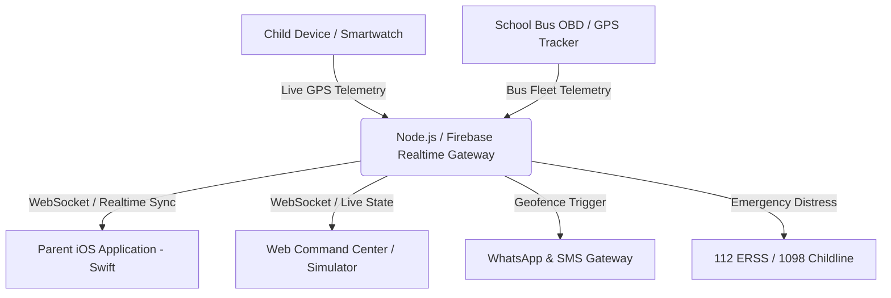

# Kid Buddy Bharat (बाल रक्षक) 🇮🇳
### Real-Time Child Location Tracker, School Bus GPS Monitor & Emergency Safety System

[](LICENSE)
[](#architecture)
[](https://swift.org)
[](https://nodejs.org)
[](#national-emergency-helpline-integration)
[](CONTRIBUTING.md)

<p align="center">
  
</p>

**Kid Buddy Bharat (बाल रक्षक)** is a next-generation real-time child tracking, school bus monitoring, and family safety platform designed specifically for Indian families and schools. It combines a native **iOS Swift** application with a cross-platform **Web Command Center & Simulator**, enabling parents to monitor their children's whereabouts, receive instant geofence alerts, track school buses, and trigger immediate emergency distress protocols connected to India's **112 National Emergency Helpline** and **1098 Childline**.

---

## 🌟 Key Highlights

### 📍 1. Real-Time High-Accuracy GPS Tracking
* **Live Location Monitoring**: Continuously streams precise GPS coordinates with NavIC / WGS84 positioning.
* **Child Profile Telemetry**: Monitors battery percentage, network carrier (Jio 5G / Airtel 5G), movement speed, and current landmark.
* **Map Layer Switcher**: Seamlessly toggle between High-Contrast Standard Streets and ESRI Satellite Hybrid imagery.
* **Multi-Child Dashboard**: Easily monitor multiple children (e.g. *Arpit Kaur*, *Alisha*, *Neerja Thakur*) from a single unified view.

### 🚌 2. School Bus & Van Live Route Tracker
* **Live Route Telemetry**: Track school bus routes (e.g. *Route #14B, KA-01-F-4589*) with live stops and ETAs.
* **Driver & Attendant Details**: Instant access to driver contact (*Ramesh Bhaiya*) and female attendant (*Sunita Didi*).
* **Speed Compliance Monitor**: Automatic speed governor alerts flagging speeds exceeding RTO school zone limits (40 km/h).

### 🏠 3. Geofencing & Smart Safe Zones
* **Perimeter Geofences**: Define customizable safe zones with radial fences (150m to 1000m) around School, Home, Tuition/Coaching, and Metro Stations.
* **Instant Arrival / Departure Notifications**: Real-time push, SMS, and WhatsApp alerts when a child enters or leaves designated areas.

### 🗺️ 4. Movement History & Route Replay
* **Location Breadcrumbs**: Full chronological waypoint timeline of the day's movements with reverse-geocoded addresses.
* **Scrubber Playback**: Interactive route replay tool with variable playback speeds (1x, 2x, 5x) to review historical commutes.

### 💬 5. In-App Family Chat
* **Encrypted Two-Way Messaging**: Direct chat between parent and child with quick preset status chips (*"Bus me baith gayi?", "Tuition done?", "Lunch khaya?"*).
* **Media & Photo Sharing**: Children can quickly send photo checkpoints of arrival landmarks.

### 🚨 6. 112 National Emergency SOS & Critical Siren
* **Loud Siren Override**: Plays high-decibel alert audio (`criticalAlert.wav`) overriding silent modes during distress.
* **Dial 112 ERSS**: One-tap direct dispatch to India's **112 Emergency Response Support System**.
* **1098 Childline Integration**: Direct link to the national 24/7 child protection helpline.
* **Automatic Distress Broadcast**: Transmits coordinates and battery status via SMS and WhatsApp to designated family guardians.

### 🇮🇳 7. Indian Localization & Multi-City Presets
* **City Presets**: Out-of-the-box geographic presets for **Bengaluru** (Indiranagar), **Delhi NCR** (Connaught Place / R.K. Puram), and **Mumbai** (Bandra West).
* **Bilingual Support**: Instant toggle between **English** and **हिंदी (Hindi)**.

---

## 🏗️ Architecture & Technology Stack



### Mobile Application (Native iOS)
* **Language & Framework**: Swift 5.0, UIKit, Storyboards
* **Mapping**: Apple MapKit, CoreLocation, GeoFire
* **Authentication & OTP**: SwiftOTP (6-Digit Dynamic Time-based Verification)
* **Cloud & Push Notifications**: Firebase Database, Firebase Messaging (FCM)
* **Dependency Management**: CocoaPods

### Web Simulator & Command Center
* **Server**: Zero-dependency Node.js HTTP Server (`server.js`)
* **Interactive Maps**: Leaflet.js, OpenStreetMap, ESRI World Imagery
* **Styling**: Apple iOS 18 Design System, Glassmorphism, Dark Mode, Responsive Design
* **Geodesy Math**: Haversine Spherical Distance Algorithm

---

## 📁 Repository Structure

```
Kid-Buddy/
├── Kid Buddy/                      # Native iOS Swift Project
│   ├── Controllers/               # ViewControllers (MVC Architecture)
│   │   ├── TrackingViewController.swift          # Live MapKit tracking & carousel
│   │   ├── ChatViewController.swift              # Two-way in-app messaging
│   │   ├── HistoryViewController.swift           # Polyline route & history replay
│   │   ├── AddObservedPlacesViewController.swift # Geofencing safe zone setup
│   │   ├── AddChildViewController.swift          # Device pairing & profiles
│   │   └── ListViewController.swift              # Settings & SOS trigger
│   ├── Models/                    # Data models (User, Message, ChildAnnotation)
│   ├── utilities/                 # CoreLocation handler & Firebase data handler
│   ├── Views/                     # Main.storyboard & Custom Cell XIBs
│   └── supporting files/          # Assets, AppIcon, and criticalAlert.wav
├── Kid Buddy.xcworkspace          # Xcode Workspace (CocoaPods)
├── Podfile                        # CocoaPods dependencies
├── web/                           # Web Command Center & Live Simulator
│   ├── index.html                 # Apple simulator & multi-tab interface
│   ├── style.css                  # Premium iOS design system
│   ├── app.js                     # Live GPS simulation, geofencing, chat & 112 SOS
│   └── server.js                  # Lightweight Node.js local web server
└── README.md                      # Project documentation
```

---

## 🚀 Quick Start Guide

### Option 1: Run Web Simulator & Command Center (Cross-Platform / Windows / Mac / Linux)

Ensure you have **Node.js** installed (v16 or higher).

1. **Clone the repository:**
   ```bash
   git clone https://github.com/BCASTUDENT28/Kid-Buddy.git
   cd Kid-Buddy
   ```

2. **Start the local server:**
   ```bash
   node web/server.js
   ```

3. **Open in your browser:**
   ```
   http://localhost:8095
   ```

### Option 2: Run Native iOS App in Xcode (macOS Required)

1. **Navigate to the iOS directory:**
   ```bash
   cd "Kid-Buddy"
   ```

2. **Install CocoaPods dependencies:**
   ```bash
   pod install
   ```

3. **Open Xcode Workspace:**
   ```bash
   open "Kid Buddy.xcworkspace"
   ```

4. **Run on iOS Simulator or connected iPhone** (Target: iOS 14.0+).

---

## 🇮🇳 National Emergency Helpline Integration

| Service | Number | Description |
| :--- | :--- | :--- |
| **National Emergency (ERSS)** | **112** | All-in-one emergency response for Police, Fire, and Ambulance across India. |
| **Childline India** | **1098** | 24-hour free emergency phone service for children in need of care and protection. |
| **Police Control Room** | **100** | Direct Police emergency line. |
| **Ambulance Services** | **102 / 108** | Emergency medical assistance and dispatch. |

---

## 🔒 Privacy & Safety Compliance

Kid Buddy Bharat follows stringent privacy safeguards:
- **Child Protection First**: GPS telemetry is encrypted and accessible strictly by authenticated guardians.
- **Battery Optimization**: Implements adaptive location accuracy (`kCLLocationAccuracyBest` only when moving, throttling when stationary).
- **No Third-Party Ad Trackers**: Completely ad-free environment prioritizing child security.

---

## 🤝 Contributing

Contributions, issues, and feature requests are welcome!
Feel free to check [issues page](https://github.com/BCASTUDENT28/Kid-Buddy/issues).

1. Fork the Project
2. Create your Feature Branch (`git checkout -b feature/AmazingFeature`)
3. Commit your Changes (`git commit -m 'Add some AmazingFeature'`)
4. Push to the Branch (`git push origin feature/AmazingFeature`)
5. Open a Pull Request

---

## 📄 License

Distributed under the **MIT License**. See `LICENSE` for more information.

<p align="center">
  Crafted with ❤️ for child safety in India • <b>Kid Buddy Bharat (बाल रक्षक)</b>
</p>
